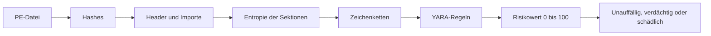

PE-Sentinel ist ein Kommandozeilenwerkzeug in Python. Es analysiert Windows-PE-Dateien (`.exe` und `.dll`) statisch, also ohne sie auszuführen. Jede Datei wird als unauffällig, verdächtig oder schädlich eingestuft, und das Werkzeug nennt die Gründe.

## Das Problem

Ein einzelnes Signal, etwa eine hohe Entropie, sagt für sich genommen wenig aus. Ich wollte das Gegenteil eines Black-Box-Urteils: ein Werkzeug, das eine Datei anhand ihrer eigenen Struktur bewertet — Hashes, Importe, Entropie, Zeichenketten, YARA — und genau auflistet, welche Befunde den Wert erhöht haben, sodass sich das Ergebnis prüfen statt nur glauben lässt. Genau diese nachvollziehbare Bewertung, bei der sich jeder Punkt auf einen Grund zurückführen lässt, war der Kern des Projekts.

## Was ich gebaut habe

- **Fingerabdruck der Datei:** SHA-256- und MD5-Hashes sowie eine Prüfung des PE-Headers.
- **Auswertung des PE-Headers** mit `pefile`: Architektur, Kompilierzeitpunkt, Sektionstabelle, Importe, Exporte und ob eine Authenticode-Signatur vorhanden ist.
- **Erkennung verdächtiger Importe:** eine kuratierte Liste von rund 40 Windows-APIs, die Malware häufig missbraucht (Injektion, Hooking, Anti-Debugging, Kryptografie, C2).
- **Import-Kombinationen:** markiert gefährliche Gruppen wie `VirtualAllocEx` + `WriteProcessMemory` + `CreateRemoteThread`.
- **Entropie-Analyse:** Shannon-Entropie je Sektion, mit einer Schwelle von 7,2 von 8,0 für gepackte oder verschlüsselte Sektionen.
- **Hinweise auf Packer:** Abweichungen zwischen virtueller und roher Sektionsgröße.
- **Extraktion von Zeichenketten:** ASCII- und UTF-16LE-Zeichenketten, durchsucht nach IP-Adressen, URLs, Registry-Pfaden, PowerShell-Mustern und Base64-Blöcken.
- **YARA-Prüfung** über `yara-python`, mit drei Beispielregeln: UPX-Packer, PowerShell-Aufruf und Einsprungpunkt-Signaturen bekannter Packer.
- **Stapelmodus** für ganze Ordner.
- **Unit-Tests** für Entropie, Fingerabdruck, Zeichenketten und das Urteil.

## So funktioniert es

Jede Prüfung liefert Hinweise. Das Ergebnis ist ein Risikowert von 0 bis 100 mit einzeln aufgeführten Gründen.



Der Code ist genauso aufgeteilt:

| Modul | Aufgabe |
| --- | --- |
| `main.py` | Einstiegspunkt der Kommandozeile |
| `analyzer/fingerprint.py` | Hashes und Prüfung der PE-Signatur |
| `analyzer/static/pe_parser.py` | Auswertung von Header, Importen und Exporten |
| `analyzer/static/entropy.py` | Shannon-Entropie je Sektion |
| `analyzer/static/strings.py` | Extraktion von Zeichenketten und Mustersuche |
| `analyzer/static/yara_scan.py` | Kompilieren und Anwenden der YARA-Regeln |
| `analyzer/scoring/verdict.py` | Risikowert und Urteil |
| `analyzer/output/printer.py` | Bericht im Terminal |

## Verwendung

```bash title="Eine Datei oder einen ganzen Ordner analysieren"
$ python main.py analyze samples/notepad.exe
$ python main.py analyze samples/notepad.exe --verbose
$ python main.py batch samples/
```

## Das Bewertungssystem

Jeder Punkt im Risikowert lässt sich auf einen einzelnen Befund zurückführen.

| Signal | Punkte je Treffer | Obergrenze |
| --- | ---: | ---: |
| Verdächtiger Import | 2,0 | 16,0 |
| Import-Kombination | 8,0 | 20,0 |
| Gepackte Sektion (Entropie über 7,2) | 6,0 | 18,0 |
| Abweichung virtuelle/rohe Größe | 4,0 | 18,0 (gemeinsam mit Entropie) |
| YARA-Treffer | 10,0 | 30,0 |
| Verdächtige Zeichenkette | 1,5 | 12,0 |
| Fehlende Authenticode-Signatur | 4,0 | |
| Auffälliger Kompilierzeitpunkt | 3,0 | |
| EXE mit Exporttabelle | 3,0 | |

| Risikowert | Urteil |
| --- | --- |
| 0 bis 30 | Unauffällig |
| 31 bis 60 | Verdächtig |
| 61 bis 100 | Schädlich |

Hinter der Tabelle stehen drei Entscheidungen:

- **Obergrenzen verhindern, dass eine Kategorie allein entscheidet.** Selbst eine Datei, die jede YARA-Regel trifft, erhält über YARA höchstens 30 Punkte. Für „schädlich“ braucht es zusätzlich Importe oder Hinweise auf Packer.
- **Kombinationen wiegen schwerer als einzelne Importe.** Eine Datei, die sowohl `WriteProcessMemory` als auch `CreateRemoteThread` importiert, ist weit verdächtiger als eine, die nur eine davon importiert.
- **Der Wert ist eine Summe.** Der Bericht führt jeden Befund mit seinen genauen Punkten auf, sodass sich das Urteil nachprüfen lässt.

## Ergebnisse in Zahlen

| Kennzahl | Wert |
| --- | --- |
| Windows-APIs auf der Beobachtungsliste | rund 40 |
| Hashes pro Datei | 2 (SHA-256, MD5) |
| Mitgelieferte YARA-Regeln | 3 |
| Unit-Tests | 26, alle bestanden |
| Bereich des Risikowerts | 0 bis 100 |
| Urteile | 3 (unauffällig, verdächtig, schädlich) |

Zwei Windows-Programme aus einem Stapeldurchlauf:

| Datei | Wert | Urteil | Begründung |
| --- | ---: | --- | --- |
| `notepad.exe` | 30 | Unauffällig | 6 markierte Importe, 7 Treffer bei Zeichenketten, keine eingebettete Signatur und ein Kompilierzeitpunkt in der Zukunft. Keine Hinweise auf Packer, kein YARA-Treffer. |
| `certutil.exe` | 35 | Verdächtig | Es importiert mehr sensible APIs (Kryptografie, Netzwerk, Registry). Das passt zu einem Zertifikatswerkzeug und ist zugleich der Grund, warum Angreifer es als „Living-off-the-Land“-Programm missbrauchen. |

## Grenzen

- Der Stapelmodus durchsucht keine Unterordner und überspringt Dateien, die keine PE-Dateien sind.
- Bei Authenticode wird nur geprüft, ob eine Signatur vorhanden ist. Die Zertifikatskette wird nicht validiert.
- Das Werkzeug führt nie eine Datei aus. Echte Malware sollte trotzdem nur in einer isolierten virtuellen Maschine untersucht werden.

## Was ich gelernt habe

Ein einzelnes Signal sagt für sich genommen wenig aus. Der Wert entsteht, wenn man schwache Signale kombiniert und erklärt, warum eine Datei markiert wurde.
