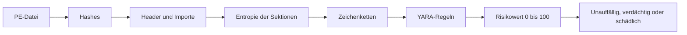

PE-Sentinel ist ein Kommandozeilenwerkzeug in Python. Es analysiert Windows-PE-Dateien (`.exe` und `.dll`) statisch, also ohne sie auszuführen. Jede Datei wird als unauffällig, verdächtig oder schädlich eingestuft, und das Werkzeug nennt die Gründe.

## Das Problem

Ein einzelnes Signal, etwa eine hohe Entropie, sagt für sich genommen wenig aus.

> [!todo] TODO
> Devansh: Ergänze ein oder zwei Sätze dazu, was dich zu diesem Projekt gebracht hat.

## Was ich gebaut habe

- Berechnet für jede Datei SHA-256- und MD5-Hashes.
- Liest PE-Header und Importe mit `pefile` aus.
- Markiert rund 40 häufig missbrauchte Windows-APIs.
- Markiert Kombinationen für Prozessinjektion wie `VirtualAllocEx` + `WriteProcessMemory` + `CreateRemoteThread`.
- Erkennt Packer über die Shannon-Entropie jeder Sektion und über Abweichungen zwischen virtueller und roher Sektionsgröße.
- Extrahiert Zeichenketten und markiert IP-Adressen, URLs, Registry-Pfade, PowerShell-Befehle und Base64-Blöcke.
- Wendet eigene YARA-Regeln über `yara-python` an.
- Hat einen Stapelmodus für ganze Ordner.
- Ist durch Unit-Tests mit `pytest` abgedeckt.

## So funktioniert es

Jede Prüfung liefert Hinweise. Das Ergebnis ist ein Risikowert von 0 bis 100 mit einzeln aufgeführten Gründen.

## Ergebnisse in Zahlen

| Kennzahl | Wert |
| --- | --- |
| Windows-APIs auf der Beobachtungsliste | rund 40 |
| Hashes pro Datei | 2 (SHA-256, MD5) |
| Bereich des Risikowerts | 0 bis 100 |
| Einstufungen | 3 (unauffällig, verdächtig, schädlich) |

> [!todo] TODO
> Devansh: Ergänze die Zahl der Unit-Tests und der geprüften Dateien, falls du sie hast.

## Was ich gelernt habe

Ein einzelnes Signal sagt für sich genommen wenig aus. Der Wert entsteht, wenn man schwache Signale kombiniert und erklärt, warum eine Datei markiert wurde.
