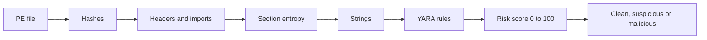

PE-Sentinel is a Python command-line tool that statically analyses Windows PE files (`.exe` and `.dll`) without executing them. It classifies each file as clean, suspicious or malicious, and says why.

## The problem

A single signal, such as high entropy, means little on its own.

> [!todo] TODO
> Devansh: add one or two sentences on what made you start this project.

## What I built

- **File fingerprinting:** SHA-256 and MD5 hashes, plus validation of the PE header.
- **PE header parsing** with `pefile`: architecture, compile timestamp, section table, imports, exports, and whether an Authenticode signature is present.
- **Suspicious import detection:** a curated list of about 40 Windows APIs commonly abused by malware (injection, hooking, anti-debug, crypto, C2).
- **Import combinations:** flags dangerous groups such as `VirtualAllocEx` + `WriteProcessMemory` + `CreateRemoteThread`.
- **Entropy analysis:** per-section Shannon entropy, with a threshold of 7.2 out of 8.0 for packed or encrypted sections.
- **Packing indicators:** mismatches between virtual and raw section sizes.
- **String extraction:** ASCII and UTF-16LE strings, scanned for IPs, URLs, registry paths, PowerShell patterns and Base64 blobs.
- **YARA scanning** through `yara-python`, with three example rules: UPX packer, PowerShell invocation, and packer entry-point signatures.
- **Batch mode** for whole folders.
- **Unit tests** for entropy, fingerprinting, strings and the verdict.

## How it works

Each check adds evidence. The result is a risk score from 0 to 100 with itemised reasons.



The code is split the same way:

| Module | Job |
| --- | --- |
| `main.py` | Command-line entry point |
| `analyzer/fingerprint.py` | Hashing and PE magic validation |
| `analyzer/static/pe_parser.py` | Header, import and export analysis |
| `analyzer/static/entropy.py` | Shannon entropy per section |
| `analyzer/static/strings.py` | String extraction and pattern scanning |
| `analyzer/static/yara_scan.py` | YARA rule compilation and scanning |
| `analyzer/scoring/verdict.py` | Score and verdict |
| `analyzer/output/printer.py` | Terminal report |

## Using it

```bash title="Analyse one file, or a whole folder"
$ python main.py analyze samples/notepad.exe
$ python main.py analyze samples/notepad.exe --verbose
$ python main.py batch samples/
```

## The scoring system

Every point in the score traces back to one finding.

| Signal | Points each | Cap |
| --- | ---: | ---: |
| Suspicious import | 2.0 | 16.0 |
| Import combination | 8.0 | 20.0 |
| Packed section (entropy above 7.2) | 6.0 | 18.0 |
| Virtual/raw size mismatch | 4.0 | 18.0 (shared with entropy) |
| YARA rule match | 10.0 | 30.0 |
| Suspicious string | 1.5 | 12.0 |
| Missing Authenticode signature | 4.0 | |
| Compile timestamp anomaly | 3.0 | |
| EXE with an export table | 3.0 | |

| Score | Verdict |
| --- | --- |
| 0 to 30 | Clean |
| 31 to 60 | Suspicious |
| 61 to 100 | Malicious |

Three design choices sit behind the table:

- **Caps stop one category from deciding the verdict.** Even a file that matches every YARA rule gets at most 30 points from YARA. It needs imports or packing as well to reach "malicious".
- **Combinations weigh more than single imports.** A binary that imports both `WriteProcessMemory` and `CreateRemoteThread` is far more suspicious than one that imports either alone.
- **The score is additive.** The report lists every finding with its exact points, so the verdict can be audited.

## Results in numbers

| Measure | Value |
| --- | --- |
| Windows APIs on the watch list | about 40 |
| Hashes per file | 2 (SHA-256, MD5) |
| YARA rules shipped | 3 |
| Unit tests | 26, all passing |
| Risk score range | 0 to 100 |
| Verdicts | 3 (clean, suspicious, malicious) |

Two Windows binaries from a batch run:

| File | Score | Verdict | Why |
| --- | ---: | --- | --- |
| `notepad.exe` | 30 | Clean | 6 flagged imports, 7 string matches, no embedded signature, and a future-looking compile timestamp. No packing, no YARA match. |
| `certutil.exe` | 35 | Suspicious | It imports a wider set of sensitive APIs (crypto, networking, registry). That is accurate for a certificate utility, and it is also why attackers abuse it as a living-off-the-land binary. |

## Limits

- Batch mode does not descend into sub-folders, and it skips files that are not PE files.
- Authenticode is checked for presence only. The signature chain is not validated.
- The tool never executes a file. Real malware should still only be handled inside an isolated virtual machine.

## What I learned

A single signal means little on its own. The value comes from combining weak signals and explaining why a file was flagged.
