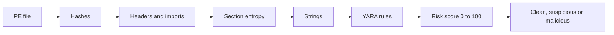

PE-Sentinel is a Python command-line tool that statically analyses Windows PE files (`.exe` and `.dll`) without executing them. It classifies each file as clean, suspicious or malicious, and says why.

## The problem

A single signal, such as high entropy, means little on its own.

> [!todo] TODO
> Devansh: add one or two sentences on what made you start this project.

## What I built

- Hashes each file with SHA-256 and MD5.
- Parses PE headers and imports with `pefile`.
- Flags about 40 commonly abused Windows APIs.
- Flags process-injection combinations such as `VirtualAllocEx` + `WriteProcessMemory` + `CreateRemoteThread`.
- Detects packing from per-section Shannon entropy and from mismatches between virtual and raw section sizes.
- Extracts strings and flags IPs, URLs, registry paths, PowerShell commands and Base64 blobs.
- Runs custom YARA rules through `yara-python`.
- Has a batch mode for whole folders.
- Is covered by `pytest` unit tests.

## How it works

Each check adds evidence. The result is a risk score from 0 to 100 with itemised reasons.

## Results in numbers

| Measure | Value |
| --- | --- |
| Windows APIs on the watch list | about 40 |
| Hashes per file | 2 (SHA-256, MD5) |
| Risk score range | 0 to 100 |
| Verdicts | 3 (clean, suspicious, malicious) |

> [!todo] TODO
> Devansh: add the number of unit tests and the number of samples you ran it against, if you have them.

## What I learned

A single signal means little on its own. The value comes from combining weak signals and explaining why a file was flagged.
