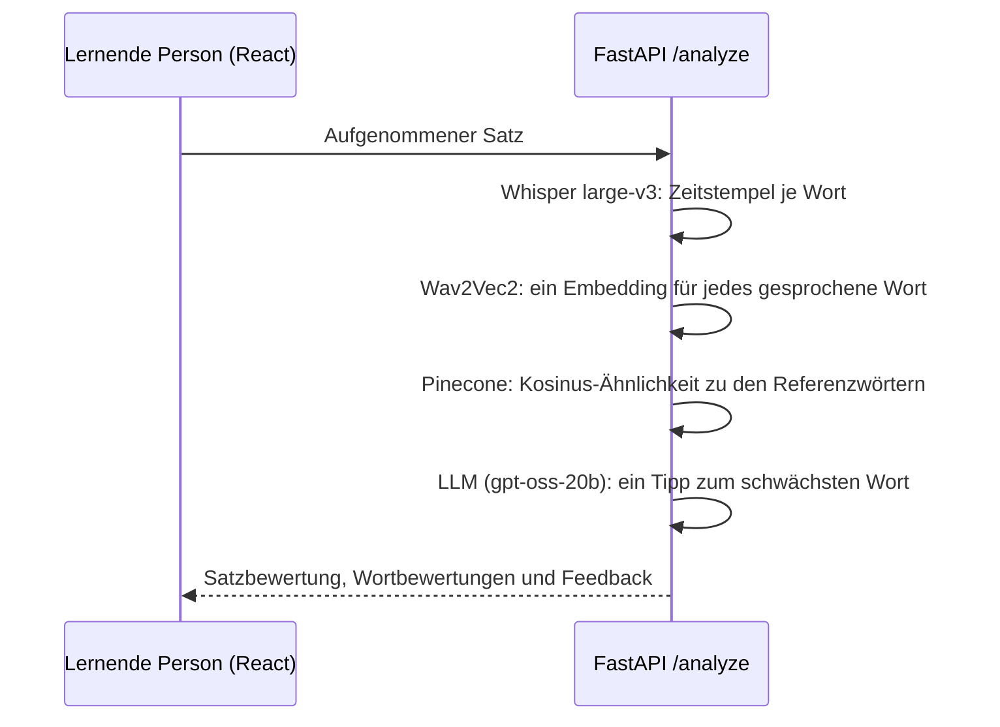

Eine Webplattform, die die Aussprache von gesprochenem Englisch trainiert. Die lernende Person liest einen Satz laut vor, das System bewertet jedes Wort im Vergleich zu Referenzaufnahmen, zeigt das schwächste Wort an und gibt kurzes Feedback, wie es besser geht. Es war ein Teamprojekt und zugleich mein Pflichtpraktikum im Abschlussjahr bei AnantaCode in Gandhinagar. Meine Aufgabe waren Entwicklung und Test.

## Was die Plattform kann

- Anmeldung mit E-Mail und Passwort sowie mit Google (Firebase Authentication).
- Aufnahme im Browser oder Hochladen einer Audiodatei.
- Bewertung der Aussprache für jedes Wort und für den ganzen Satz.
- KI-Feedback, das sich auf das schwächste Wort konzentriert.
- 34 Übungssätze in 5 Schwierigkeitsstufen; die nächste Stufe wird über die erreichte Punktzahl freigeschaltet.
- Übungsverlauf, tägliche Serien und eine Bestenliste (Cloud Firestore).
- Heller und dunkler Modus.

Eine vollständige Antwort dauert in der Regel 5 bis 10 Sekunden.

## So funktioniert es



Die Referenzdaten werden vorab erzeugt. Die Übungssätze werden in Phoneme umgewandelt, mit Piper TTS eingesprochen, in Wörter zerlegt, mit Wav2Vec2 in Embeddings umgewandelt und in Pinecone gespeichert.

| Ebene | Technologie |
| --- | --- |
| Frontend | React 19, React Router, Tailwind CSS |
| Anmeldung und Datenbank | Firebase Authentication, Cloud Firestore |
| Backend | FastAPI, Uvicorn |
| Spracherkennung | OpenAI Whisper (large-v3) |
| Audio-Embeddings | Wav2Vec2 (`facebook/wav2vec2-base-960h`) |
| Vektordatenbank | Pinecone |
| Feedback | Groq-API (`openai/gpt-oss-20b`) |
| Referenzaufnahmen | Piper TTS, g2p_en, CMU Pronouncing Dictionary |

## Die API

`POST /analyze` erhält die Aufnahme und die ID des Zielsatzes und liefert:

```json
{
  "sentence_score": 0.84,
  "weakest_word": "fragrance",
  "feedback": "Try stretching the 'gr' sound a little more…",
  "word_scores": [{ "word": "a", "score": 0.91 }]
}
```

## Was ich getestet habe

Ich habe 15 funktionale Tests und Integrationstests geschrieben und durchgeführt.

| Durchlauf | Bestanden | Anmerkung |
| --- | --- | --- |
| Erster Durchlauf | 12 von 15 | 3 Fehler gefunden |
| Nach den Korrekturen | 15 von 15 | Erneut getestet, bis alle Fälle bestanden waren |

Zwei der Fehler aus dem ersten Durchlauf:

- Ein Zeitzonenfehler unterbrach die täglichen Serien bei allen, die nach 17:30 Uhr IST übten.
- Ein Diagramm stürzte ab, wenn weniger als 2 Sitzungen vorlagen.

Zu den Fällen gehörten Negativ- und Grenzwerttests: ein falsches Passwort, ein nicht unterstützter Dateityp und die 70 % der Punkte, die für die nächste Stufe nötig sind.

## Ein stiller Fehler, der festgehalten gehört

Das Feedback-Modell, mit dem das Projekt entwickelt wurde, wurde später vom Anbieter eingestellt. Anfragen daran schlugen fehl, und weil das Backend bei jedem Fehler auf eine feste Nachricht zurückfiel, bemerkte niemand einen Fehler: Alle Lernenden bekamen denselben allgemeinen Tipp. Das Backend nutzt jetzt `openai/gpt-oss-20b`, und Fehler des Anbieters werden auf dem Server protokolliert, sodass ein eingestelltes Modell sofort auffällt.

## Was ich gelernt habe

> [!todo] TODO
> Devansh: Ergänze, was dir dieses Projekt über das Testen im Team gezeigt hat.
