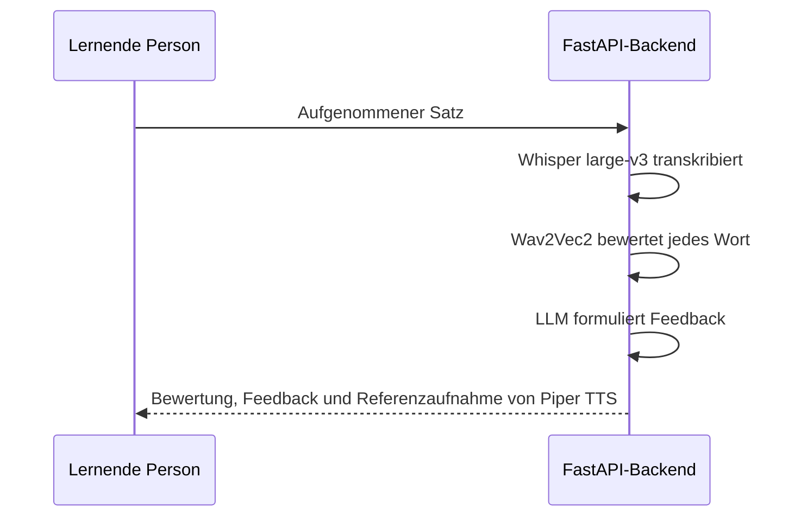

Eine Webplattform, die die Aussprache von gesprochenem Englisch trainiert. Es war ein Teamprojekt und zugleich mein Pflichtpraktikum im Abschlussjahr bei AnantaCode in Gandhinagar. Meine Aufgabe waren Entwicklung und Test.

## Was die Plattform kann

- Whisper large-v3 transkribiert, was die lernende Person spricht.
- Wav2Vec2 bewertet die Aussprache Wort für Wort.
- Piper TTS spielt eine Referenzaufnahme ab.
- Eine Pinecone-Vektorsuche deckt 34 Übungssätze in 5 Schwierigkeitsstufen ab.
- Ein LLM (gpt-oss-20b) formuliert persönliches Feedback.
- Es gibt eine Bestenliste, tägliche Serien, gesperrte Stufen und Fortschrittsauswertungen.

Die Plattform besteht aus einem FastAPI-Backend, einem React-19-Frontend sowie Firebase Authentication und Firestore. Eine vollständige Antwort dauert in der Regel 5 bis 10 Sekunden.

## Was ich getestet habe

Ich habe 15 funktionale Tests und Integrationstests geschrieben und durchgeführt.

| Durchlauf | Bestanden | Anmerkung |
| --- | --- | --- |
| Erster Durchlauf | 12 von 15 | 3 Fehler gefunden |
| Nach den Korrekturen | 15 von 15 | Erneut getestet, bis alle Fälle bestanden waren |

Zwei der Fehler aus dem ersten Durchlauf:

- Ein Zeitzonenfehler unterbrach die täglichen Serien bei allen, die nach 17:30 Uhr IST übten.
- Ein Diagramm stürzte ab, wenn weniger als 2 Sitzungen vorlagen.

Zu den Fällen gehörten Negativ- und Grenzwerttests: ein falsches Passwort, ein nicht unterstützter Dateityp und die Schwelle von 70 % der Punkte, die die nächste Stufe freischaltet.

## Was ich gelernt habe

> [!todo] TODO
> Devansh: Ergänze, was dir dieses Projekt über das Testen im Team gezeigt hat.
