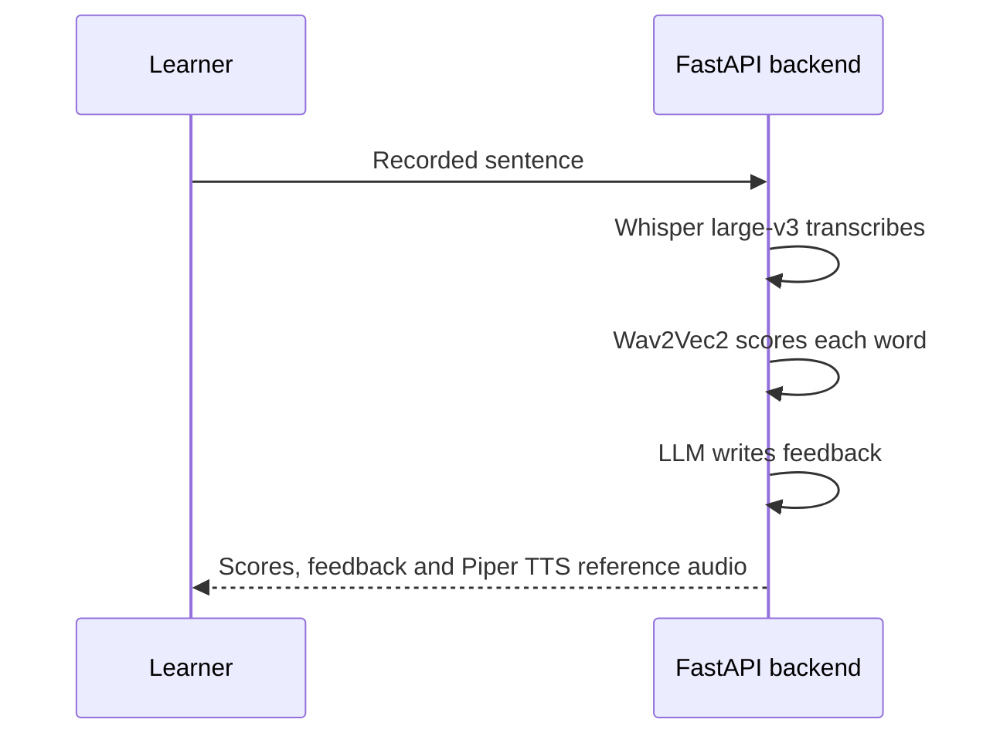

A web platform that coaches spoken English pronunciation. It was a team project and my final-year industry internship at AnantaCode, Gandhinagar. My role was development and testing.

## What the platform does

- Whisper large-v3 transcribes the learner's speech.
- Wav2Vec2 scores pronunciation at word level.
- Piper TTS plays reference audio.
- Pinecone vector search covers 34 practice sentences across 5 difficulty levels.
- An LLM (gpt-oss-20b) generates personalised feedback.
- It has a leaderboard, daily streaks, level locks and progress analytics.

It is built with a FastAPI backend, a React 19 frontend, and Firebase Authentication and Firestore. A typical end-to-end response takes 5 to 10 seconds.

## What I tested

I wrote and ran 15 functional and integration test cases.

| Run | Passed | Notes |
| --- | --- | --- |
| First run | 12 of 15 | 3 defects found |
| After the fixes | 15 of 15 | Re-tested until every case passed |

Two of the defects from the first run:

- A timezone bug broke daily streaks for users practising after 5:30 PM IST.
- A chart crashed when a learner had fewer than 2 sessions.

The cases included negative and boundary tests: a wrong password, an unsupported file type, and the 70% score threshold that unlocks the next level.

## What I learned

> [!todo] TODO
> Devansh: add what this project taught you about testing in a team.
