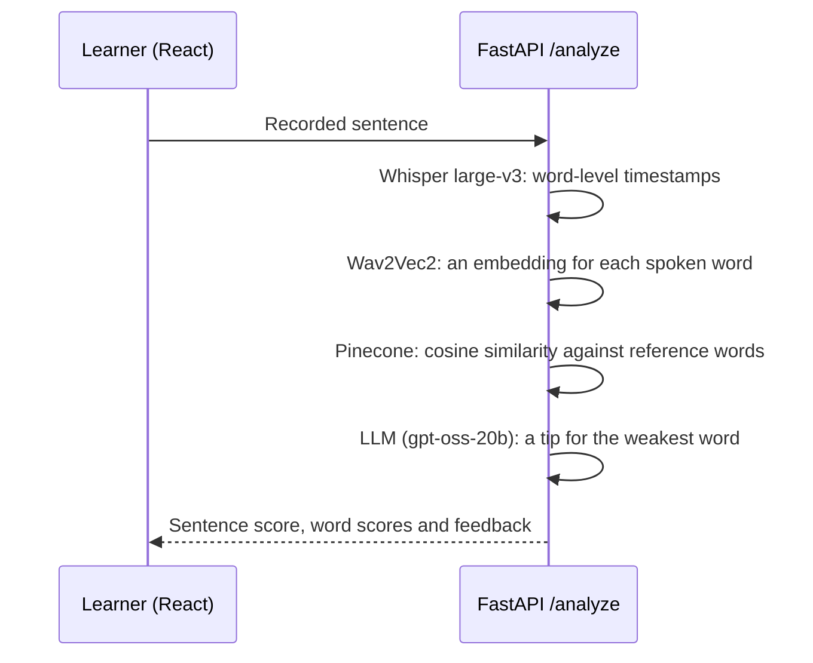

A web platform that coaches spoken English pronunciation. The learner reads a sentence aloud, the system scores each word against reference recordings, points out the weakest word, and gives short feedback on how to improve. It was a team project and my final-year industry internship at AnantaCode, Gandhinagar. My role was development and testing.

## What the platform does

- Email and password sign-in, and Google sign-in (Firebase Authentication).
- Record in the browser, or upload an audio file.
- Word-level pronunciation scores and an overall sentence score.
- AI feedback focused on the weakest word.
- 34 practice sentences across 5 difficulty levels, with score-gated progression.
- Practice history, daily streaks and a leaderboard (Cloud Firestore).
- Dark and light mode.

A typical end-to-end response takes 5 to 10 seconds.

## How it works



The reference bank is built offline. Practice sentences are converted to phonemes, synthesised with Piper TTS, split into words, embedded with Wav2Vec2 and stored in Pinecone.

| Layer | Technology |
| --- | --- |
| Frontend | React 19, React Router, Tailwind CSS |
| Auth and database | Firebase Authentication, Cloud Firestore |
| Backend | FastAPI, Uvicorn |
| Speech recognition | OpenAI Whisper (large-v3) |
| Audio embeddings | Wav2Vec2 (`facebook/wav2vec2-base-960h`) |
| Vector database | Pinecone |
| Feedback | Groq API (`openai/gpt-oss-20b`) |
| Reference audio | Piper TTS, g2p_en, CMU Pronouncing Dictionary |

## The API

`POST /analyze` takes the recording and the ID of the target sentence, and returns:

```json
{
  "sentence_score": 0.84,
  "weakest_word": "fragrance",
  "feedback": "Try stretching the 'gr' sound a little more…",
  "word_scores": [{ "word": "a", "score": 0.91 }]
}
```

## What I tested

I wrote and ran 15 functional and integration test cases.

| Run | Passed | Notes |
| --- | --- | --- |
| First run | 12 of 15 | 3 defects found |
| After the fixes | 15 of 15 | Re-tested until every case passed |

Two of the defects from the first run:

- A timezone bug broke daily streaks for users practising after 5:30 PM IST.
- A chart crashed when a learner had fewer than 2 sessions.

The cases included negative and boundary tests: a wrong password, an unsupported file type, and the 70% score needed to reach the next level.

## A silent failure worth recording

The feedback model used while the project was built was later retired by its provider. Requests to it began to fail, and because the backend fell back to a fixed message on any error, nobody saw an error: every learner got the same generic tip. The backend now uses `openai/gpt-oss-20b`, and provider errors are logged by the server, so a retired model shows up straight away.

## What I learned

The bugs that mattered most weren't the obvious ones. A timezone edge case and a silent fallback on a failed API call both passed unnoticed until someone deliberately tested the boundary or read the logs closely — which is why boundary cases and failure paths, not just the happy path, are where real testing earns its keep.
