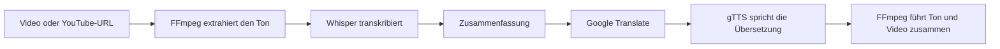

VoiceVista übersetzt die Sprache in einem Video in eine andere Sprache und spricht die Übersetzung über das Video. Außerdem extrahiert und übersetzt es Text aus Dokumenten und Bildern. Es ist im Team bei einem Hackathon entstanden.

## Was es kann

- Ein Video hochladen oder eine YouTube-URL angeben.
- Die Sprache mit dem Whisper-Modell von OpenAI transkribieren.
- Das Transkript übersetzen und die übersetzte Tonspur mit dem Originalvideo zusammenführen.
- Den Inhalt auf etwa 25 % seiner ursprünglichen Länge zusammenfassen.
- Text aus PDF- und Word-Dokumenten extrahieren und übersetzen.
- Text in Bildern mit optischer Zeichenerkennung (OCR) lesen.
- Original und Übersetzung als Text herunterladen.

Es unterstützt 11 Sprachen: Englisch, Hindi, Spanisch, Französisch, Deutsch, Gujarati, Urdu, Bengalisch, Tamil, Marathi und Kannada.

## So funktioniert die Videoübersetzung

## So funktioniert die Dokumentverarbeitung

| Eingabe | So wird der Text extrahiert |
| --- | --- |
| PDF | PyPDF2 liest jede Seite |
| Word (`.docx`) | python-docx liest jeden Absatz |
| Bild | Die Tesseract-OCR-Engine liest den Text |

Der extrahierte Text wird bereinigt, mit Google Translate übersetzt und neben dem Original angezeigt.

## Grenzen

- Lange Videos brauchen Zeit, vor allem für die Transkription mit Whisper, und mehr Arbeitsspeicher.
- Die Qualität der OCR hängt davon ab, wie deutlich das Bild ist.
- Die PDF-Extraktion funktioniert am besten mit digital erstellten PDFs, nicht mit Scans.

## Auszeichnung

VoiceVista hat den **Principal's Choice Award bei TechXcellence-2025** gewonnen. Die Veranstaltung fand am 4. und 5. April 2025 am Government Engineering College Bhavnagar statt und wurde von B2B und dem GDG GECG Bhavnagar Chapter organisiert.

## Was ich anders machen würde

Das schwächste Glied ist der Übersetzungs- und Sprachschritt. Google Translate und gTTS bringen die Wörter hinüber, verlieren aber Tonfall und Timing, sodass der synchronisierte Ton flach klingt und selten zur sprechenden Person passt. Mit mehr Zeit würde ich auf Modelle umsteigen, die die Sprechmelodie erhalten und sich an der Originalsprache ausrichten, und Whisper-Transkriptionen zwischenspeichern, damit ein langes Video die Transkription nicht zweimal bezahlt.
