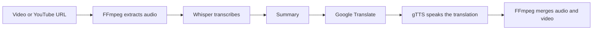

VoiceVista translates the speech in a video into another language and dubs it back over the video. It also extracts and translates text from documents and images. It was built by a team at a hackathon.

## What it does

- Upload a video, or give a YouTube URL.
- Transcribe the speech with OpenAI's Whisper model.
- Translate the transcript and merge the translated audio with the original video.
- Summarise the content to about 25% of its original length.
- Extract and translate text from PDF and Word documents.
- Read text from images with optical character recognition.
- Download both the original and the translated text.

It supports 11 languages: English, Hindi, Spanish, French, German, Gujarati, Urdu, Bengali, Tamil, Marathi and Kannada.

## How video translation works

## How document processing works

| Input | How the text is extracted |
| --- | --- |
| PDF | PyPDF2 reads every page |
| Word (`.docx`) | python-docx reads every paragraph |
| Image | The Tesseract OCR engine reads the text |

The extracted text is cleaned, translated with Google Translate, and shown next to the original.

## Limits

- Long videos take time, mostly in the Whisper transcription, and need more memory.
- OCR quality depends on how clear the image is.
- PDF extraction works best on digitally created PDFs, not scans.

## Award

VoiceVista won the **Principal's Choice Award at TechXcellence-2025**, held on 4 and 5 April 2025 at Government Engineering College Bhavnagar and organised by B2B and the GDG GECG Bhavnagar Chapter.

## What I would change

The weakest link is the translation and voice step. Google Translate and gTTS get the words across but lose tone and timing, so the dubbed audio sounds flat and rarely lines up with the speaker. Given more time I would move to models that keep prosody and align to the original speech, and cache Whisper transcriptions so a long video does not pay the transcription cost twice.
