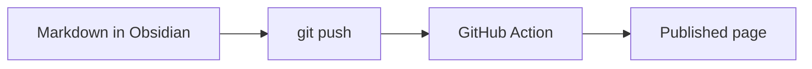

This note exists to check the renderer. It starts with `_`, so it is built in `npm run dev` and never published. %%This inline comment must not appear anywhere in the HTML.%% If you can read the word between these brackets, comments are broken: [%%LEAK%%].

%%
This block comment spans several lines.

It even has a blank line and a list:

- LEAK one
- LEAK two
%%

## Links

A note link: [[PE-Sentinel]]. With an alias: [[PE-Sentinel|the featured project]]. To a heading: [[PE-Sentinel#What I built]]. To a heading with an alias: [[pe-sentinel#how it works|how it works (lower-case target)]]. To a page: [[about]]. To a block in this note: [[#^quotable]]. To a heading in this note: [[#Callouts]].

A Markdown link to a file: [the Speech Therapy project](../projects/Speech%20Therapy.md).

A link by alias (this note's own alias is "Kitchen sink"): [[Kitchen sink]].

An unresolved link stays plain text with a dashed underline: [[A note that does not exist]].

A link to a draft is treated as unresolved in production: [[Building PE-Sentinel]].

## Images and files

Default paste name, with a caption:

![[Pasted image 20261120123456.png|A generated test image, embedded with a caption]]

The same image at 400 pixels wide:

![[Pasted image 20261120123456.png|400]]

At 400 by 225:

![[Pasted image 20261120123456.png|400x225]]

Inline in a sentence ![[Pasted image 20261120123456.png|80]] like this.

A PDF:

![[syntax-test.pdf]]

Audio:

![[syntax-test-tone.mp3]]

Video (add a `clip.mp4` to `vault/attachments/` to see the player; until then this shows the missing-attachment style):

![[clip.mp4]]

A plain link to an attachment: [[syntax-test.pdf|download the test PDF]].

## Note embeds

A whole note would be long, so here is one section of a project:

![[VoiceVista#Award]]

And one block from this note:

![[_syntax-test#^quotable]]

## Callouts

> [!note]
> A note with the default title.

> [!abstract] Abstract with a **bold** title and `code`
> Also written as `summary` or `tldr`.

> [!info]
> Info.

> [!todo]
> Todo.

> [!tip] Tip
> Also `hint` and `important`.

> [!success]
> Also `check` and `done`.

> [!question]
> Also `help` and `faq`.

> [!warning]
> Also `caution` and `attention`.

> [!failure]
> Also `fail` and `missing`.

> [!danger]
> Also `error`.

> [!bug]
> Bug.

> [!example]
> Example.

> [!quote]
> Also `cite`.

> [!tldr] An alias keeps its own word as the title when none is given
> This one is an `abstract` underneath.

> [!warning]- Folded by default
> You opened it.

> [!tip]+ Open by default, and foldable
> You can close it.

> [!question] Can callouts nest?
> > [!success] Yes
> > They can.
> > > [!example] Three levels
> > > Like this.

> [!flag]
> THM{this_flag_is_only_a_test}

> [!spoiler] Custom label on the redaction bar
> The butler did it.

## Inline formatting

==Highlighted text==, ~~struck through~~, **bold**, *italic*, ***both***, and `inline code`. A highlight can hold ==**bold** and `code`== too. This is not a highlight: a == b.

Tags: #syntax and a nested one, #syntax/nested. Not tags: #123, a URL fragment https://example.com/#section, and `#inside-code`.

Smart punctuation: "double quotes", 'single quotes', an em dash -- and an ellipsis...

A block with an ID that other notes can link to and embed. ^quotable

## Lists and tasks

- An unordered item
  - A nested item
- Another item

1. First
2. Second

- [ ] An open task
- [x] A finished task

## Table

| Offset | Bytes | Meaning | Notes that make this table wide enough to scroll on a phone |
| ---: | :---: | --- | --- |
| 0x0000 | `4D 5A` | DOS header, "MZ" | Every Windows executable starts with these two bytes |
| 0x003C | `F0 00 00 00` | Offset of the PE header | Stored in `e_lfanew` |

^the-table

## Quote and divider

> A plain blockquote, with no callout marker.

---

## Footnotes

A reference footnote.[^1] A named one.[^named] And an inline footnote, written in place.^[Inline footnotes can hold *formatting* and a [[PE-Sentinel|link]].]

[^1]: The first footnote.
[^named]: A footnote with a name, and `code`.

## Maths

Inline: the Shannon entropy of a section is $H = -\sum_{i} p_i \log_2 p_i$.

Block:

$$
H(X) = -\sum_{i=0}^{255} p(x_i)\,\log_2 p(x_i)
$$

## Diagram



## Code

```bash title="A terminal session"
$ sha256sum sample.exe
e3b0c44298fc1c149afbf4c8996fb92427ae41e4649b934ca495991b7852b855  sample.exe
$ file sample.exe
sample.exe: PE32+ executable (console) x86-64, for MS Windows
```

```powershell
PS C:\Users\analyst> Get-FileHash .\sample.exe -Algorithm SHA256
```

```python title="entropy.py" {4-6}
import math
from collections import Counter

def shannon_entropy(data: bytes) -> float:
    counts = Counter(data)
    return -sum(n / len(data) * math.log2(n / len(data)) for n in counts.values())

def looks_packed(data: bytes, threshold: float = 7.2) -> bool:
    """High entropy alone proves nothing; it is one weak signal."""
    if not data:
        return False
    return shannon_entropy(data) > threshold

print(looks_packed(open("sample.exe", "rb").read()))
```

```c
#include <stdio.h>
int main(void) { puts("hello"); return 0; }
```

```nasm
section .text
global _start
_start:
    mov rax, 60
    xor rdi, rdi
    syscall
```

```ts ins={2} del={1}
const greeting = 'hi';
const greeting = 'hello';
```

```json
{ "verdict": "suspicious", "score": 64 }
```

```yaml
rules:
  - name: packed_section
    entropy: "> 7.2"
```

```sql
SELECT name, score FROM samples WHERE verdict = 'malicious' ORDER BY score DESC;
```

```http
GET /api/samples/42 HTTP/1.1
Host: localhost:8000
Accept: application/json
```

```ini
[scanner]
threshold = 7.2
```

```diff
- entropy_only = True
+ entropy_only = False
```

## Not supported

Community-plugin syntax is not rendered: Dataview queries, Excalidraw drawings and Canvas files. Export those as images and embed the image.
